<h1 align="center">🧠 NeuroGrip</h1>

<p align="center">
  <b>AI-Powered Smart Stabilizing Spoon & Tremor Monitoring System</b><br/>
  Helping people with hand tremors eat, drink and live more independently
</p>

<p align="center">
  
  
  
  
  
  
</p>

<p align="center">
  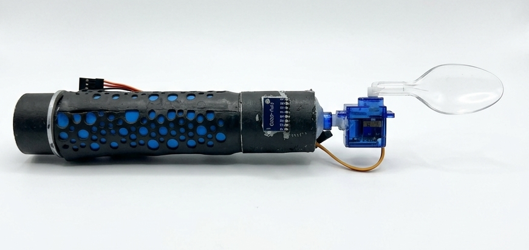
</p>

<p align="center">
  <a href="https://deepanshuguptacse2024-create.github.io/neurogrip/"><b>🌐 Live Dashboard</b></a>
</p>

---

## 📑 Table of Contents

- [About](#-about-the-project)
- [Problem Statement](#-problem-statement)
- [Key Features](#-key-features)
- [How It Works](#-how-it-works)
- [Methodology](#-methodology)
- [System Architecture](#️-system-architecture)
- [Inner Structure & Gimbal](#-inner-structure--gimbal-mechanism)
- [Data Flow](#-data-flow)
- [Hardware & Wiring](#-hardware--wiring)
- [Live Dashboard](#-live-dashboard)
- [Tech Stack](#-technology-stack)
- [Getting Started](#-getting-started)
- [Design & Ergonomics](#️-design--ergonomics)
- [Future Scope](#-future-scope)
- [Achievements](#-achievements)
- [Team](#-team)

---

## 📖 About the Project

NeuroGrip is an AI-powered smart stabilization device that helps people with hand tremors, particularly **Parkinson's disease** patients, perform daily activities independently.

An **MPU6050** accelerometer + gyroscope senses involuntary hand movement. An **ESP32** processes the signal (with on-device **TinyML** tremor detection) and drives a **2-axis servo gimbal** that moves opposite to the tremor, keeping the spoon level. Every session is streamed to **Firebase**, shown on a live web dashboard, and summarized by **Gemini AI** into a report doctors can read.

> 🏁 Built for **Smart India Hackathon 2026** · Theme: HealthTech · Category: Hardware / Software · Team **TechNova**

## 🎯 Problem Statement

People with hand tremors struggle with everyday tasks like eating, drinking and holding objects. Spilled food, loss of confidence and dependence on caregivers are common. Existing stabilizing devices are expensive, and almost none give patients or doctors usable tremor data.

**NeuroGrip** offers an affordable, sensor-based stabilizer with built-in tremor monitoring and AI reporting.

## ✨ Key Features

| | Feature | Description |
|---|---|---|
| 🎯 | **Real-time tremor detection** | MPU6050 senses 4–12 Hz tremor; TinyML (Edge Impulse) detects it at ~92.4% accuracy |
| ⚙️ | **Active tremor compensation** | Dual micro servos generate counter-movement to stabilize the spoon |
| 🧮 | **PID-based correction** | Control loop runs in 50 ms or less on the ESP32 |
| ☁️ | **Cloud sync** | Sensor data pushed to Firebase Realtime Database |
| 📈 | **Live monitoring website** | Real-time tremor waveform, intensity and stability index |
| 🩺 | **AI doctor reports** | Gemini generates a PDF report (mild / moderate / severe) after each session |
| 🕐 | **Calibration** | 30-second calibration routine before use |
| 💰 | **Affordable** | Low-cost alternative to expensive assistive devices |

## 🔁 How It Works

<p align="center">
  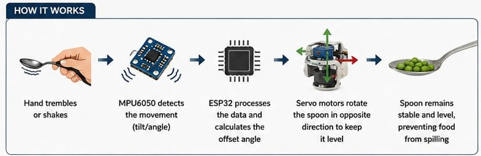
</p>

1. **Hand trembles or shakes**
2. **MPU6050 detects** the movement (tilt / angle)
3. **ESP32 processes** the data and calculates the offset angle
4. **Servo motors rotate** the spoon in the opposite direction to keep it level
5. **Spoon stays stable and level**, preventing food from spilling

## 🧪 Methodology

<p align="center">
  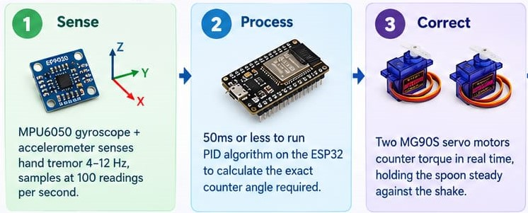
</p>

<p align="center">
  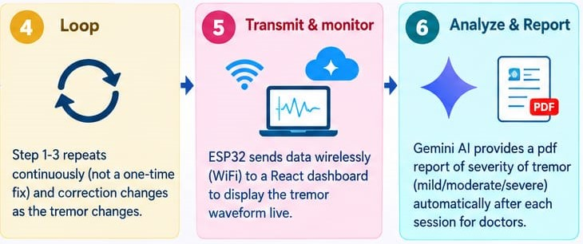
</p>

| Step | Stage | What happens |
|:---:|---|---|
| 1 | **Sense** | MPU6050 gyroscope + accelerometer senses 4–12 Hz hand tremor at 100 readings per second |
| 2 | **Process** | ESP32 runs the PID algorithm in 50 ms or less to compute the counter angle |
| 3 | **Correct** | Two servo motors apply counter-torque in real time to hold the spoon steady |
| 4 | **Loop** | Steps 1–3 repeat continuously, correction adapts as the tremor changes |
| 5 | **Transmit & monitor** | ESP32 sends data over Wi-Fi to the dashboard to show the live tremor waveform |
| 6 | **Analyze & report** | Gemini AI generates a PDF report of tremor severity after each session |

## 🏗️ System Architecture

<p align="center">
  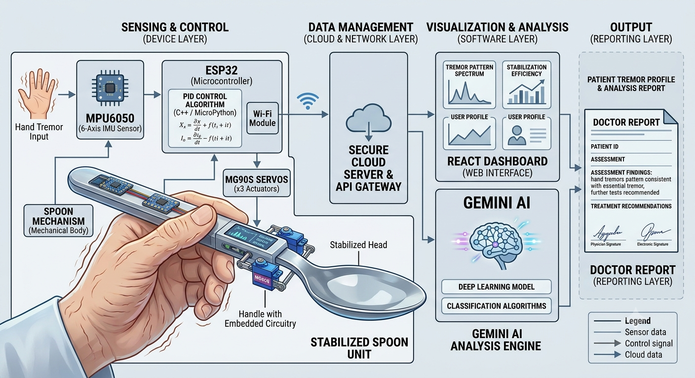
</p>

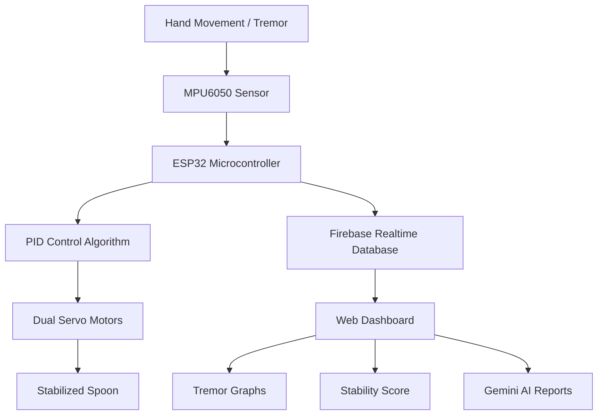


## 🔩 Inner Structure & Gimbal Mechanism

<p align="center">
  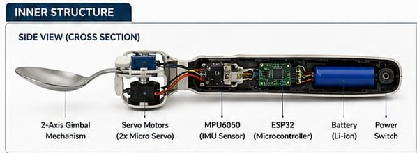
</p>

<p align="center">
  
</p>

| Axis | Servo | Motion |
|---|---|---|
| **Pitch** | Servo Motor 2 | Forward and backward tilt (up–down) |
| **Roll** | Servo Motor 1 | Left and right tilt |

Both axes work together to keep the spoon bowl **always horizontal**.

## 🔀 Data Flow

<p align="center">
  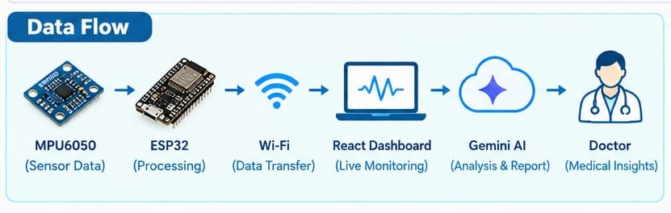
</p>

`MPU6050 (sensor data)` → `ESP32 (processing)` → `Wi-Fi (data transfer)` → `React dashboard (live monitoring)` → `Gemini AI (analysis & report)` → `Doctor (medical insights)`

## 🔌 Hardware & Wiring

### Components Used

| No. | Component | Specification | Qty |
|:---:|---|---|:---:|
| 1 | Spoon head | Stainless steel | 1 |
| 2 | Gimbal mechanism | 2-axis (pitch & roll) | 1 |
| 3 | Servo motors | Micro servo (SG90) | 2 |
| 4 | IMU sensor | MPU6050 | 1 |
| 5 | Microcontroller | ESP32 dev board | 1 |
| 6 | Battery | 3.7V Li-ion (18650) | 1 |
| 7 | Power switch | On/Off switch | 1 |
| 8 | Handle (body) | ABS plastic (ergonomic) | 1 |
| 9 | Wires & connectors | Jumper wires | Many |

### Wiring Diagram

<p align="center">
  
</p>

| From | To (ESP32) |
|---|---|
| MPU6050 VCC / GND | 3V3 / GND |
| MPU6050 SDA / SCL | GPIO21 / GPIO22 |
| Servo 1 signal | GPIO18 |
| Servo 2 signal | GPIO19 |
| Servo VCC | Battery (+) |
| All GND | Common ground |

> Pin numbers should match the firmware in the `arduino` folder.

## 📊 Live Dashboard

<p align="center">
  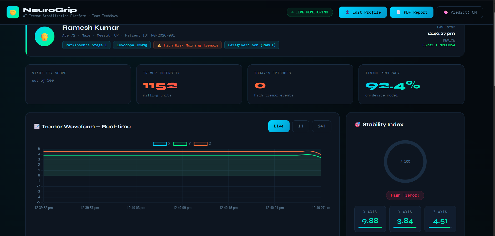
  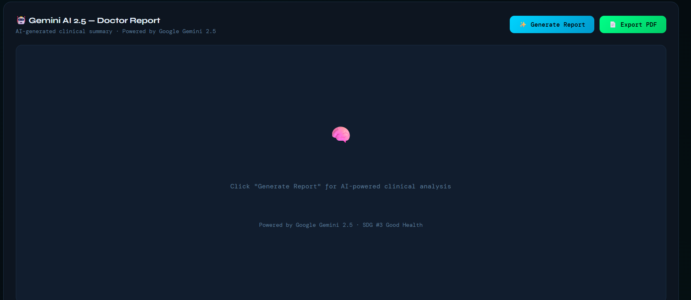
  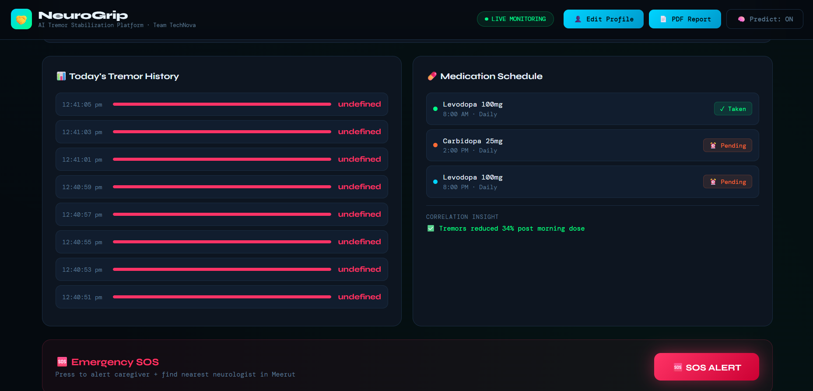
  
  
</p>

- Live tremor waveform and tremor intensity
- Stability index and tremor activity history
- Gemini AI doctor report with PDF export

👉 **[Open the live dashboard](https://deepanshuguptacse2024-create.github.io/neurogrip/)**

## 💻 Technology Stack

| Layer | Tools |
|---|---|
| Firmware | Embedded C/C++, Arduino IDE |
| Machine learning | TinyML, Edge Impulse |
| Frontend | HTML5, CSS3, JavaScript, Chart.js |
| Cloud | Firebase Realtime Database |
| AI reporting | Gemini API, jsPDF |
| Hosting | GitHub Pages |

## 🚀 Getting Started

```bash
git clone https://github.com/deepanshuguptacse2024-create/neurogrip.git
cd neurogrip
```

1. Open the firmware from the `arduino` folder in **Arduino IDE** and select your ESP32 board.
2. Add your Wi-Fi and Firebase details in the firmware.
3. Upload to the ESP32 and switch the device on.
4. Wait for the 30-second calibration, then open the [live dashboard](https://deepanshuguptacse2024-create.github.io/neurogrip/).

> 🔒 Never commit real API keys or passwords to a public repository.

```
neurogrip/
├── arduino/        # ESP32 firmware
├── app/            # Web dashboard source
├── *.png / *.jpeg  # Photos, diagrams, screenshots
├── index.html      # Dashboard entry page
└── README.md
```

## ⚖️ Design & Ergonomics

NeuroGrip is being developed in two configurations:

1. **Hand-held stabilizing spoon:** helps users while eating and drinking.
2. **Wearable hand stabilizer:** supports hand stability in everyday activities.

| Parameter | Details |
|---|---|
| Prototype weight | ~150–200 g |
| Target users | Adults and senior citizens |
| Stabilization | Dual-servo, 2-axis gimbal |
| Prototype status | ~80% complete, testing and validation ongoing |

Lightweight build · balanced weight · comfortable grip · easy operation for seniors · future tuning for different hand sizes.

> The 150–200 g figure is the reported prototype weight, not a clinically validated recommendation. Senior and pediatric designs need separate ergonomic evaluation and user testing.

## 🔮 Future Scope

- 📱 Mobile app for tremor tracking, health monitoring and progress analysis
- 🧠 Better tremor classification with larger datasets
- 🔋 Battery optimization and a more compact wearable design
- 🖐️ Ergonomic customization for different hand sizes and strengths
- 🏥 Extended performance testing and clinical evaluation

## 🏆 Achievements

<p align="center">
  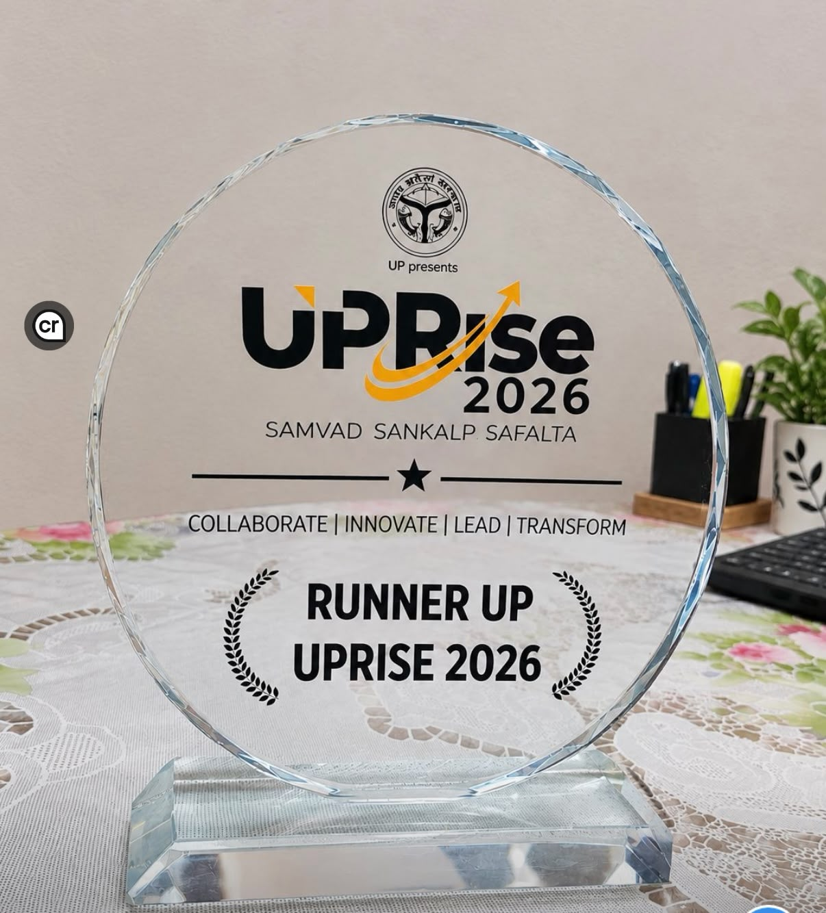
</p>

- 🥈 **2nd Position, UPRISE 2026:** for an innovative approach to AI-assisted hand tremor stabilization
- 🏅 **Top 10, Trikon 3.0** hackathon at MIET
- 🎤 Presented at **Microsoft MLSA DevGathering** and **Google Solution Challenge**
- 🇮🇳 Prepared for **Smart India Hackathon 2026** (HealthTech)

## 👥 Team

**Team TechNova**

| Name | Role |
|---|---|
| Deepanshu Gupta | Hardware, firmware, ML, dashboard |
🔗 [LinkedIn](https://www.linkedin.com/in/deepanshu-gupta-64a484378) · [GitHub](https://github.com/deepanshuguptacse2024-create)

## ⚠️ Disclaimer

NeuroGrip is an assistive technology prototype built for educational and research purposes. It is **not** a certified medical device and is not intended to diagnose, treat or cure any medical condition.

---

<p align="center">
  <b>NeuroGrip: Technology for a Steadier Tomorrow ❤️</b>
</p>
